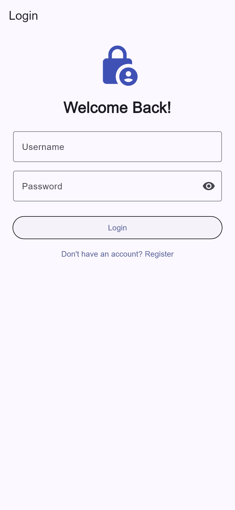
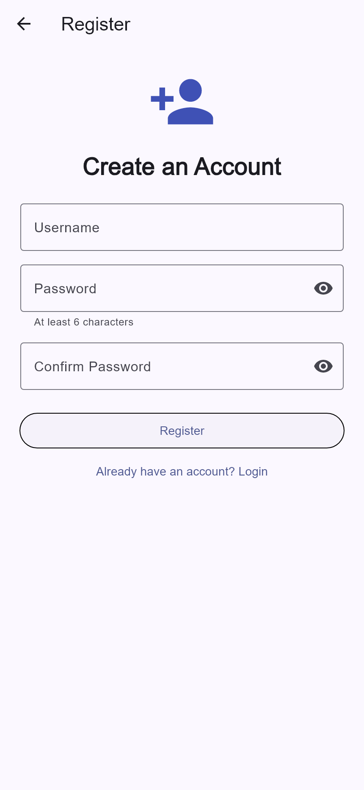
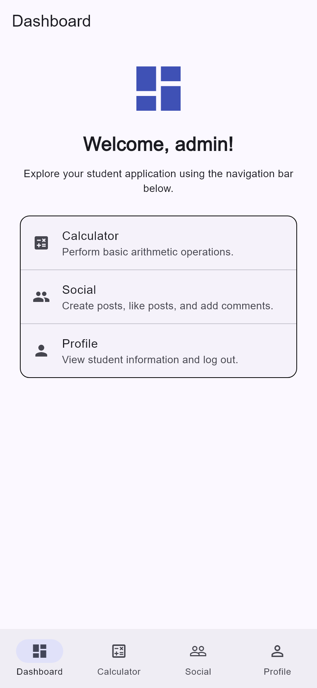
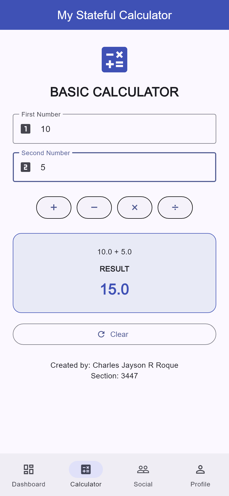
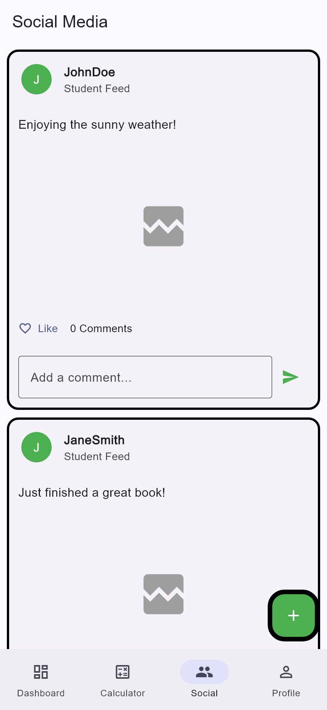
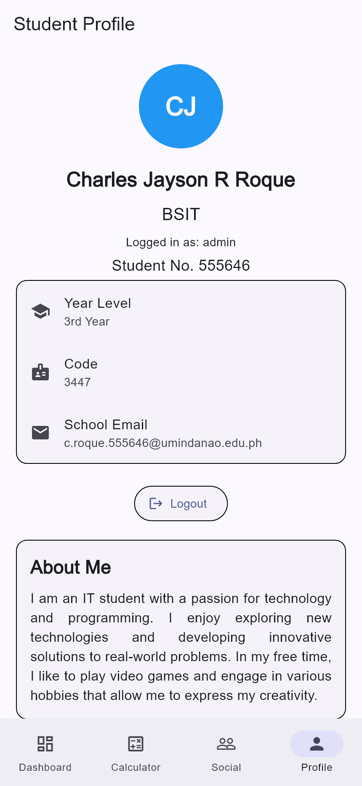
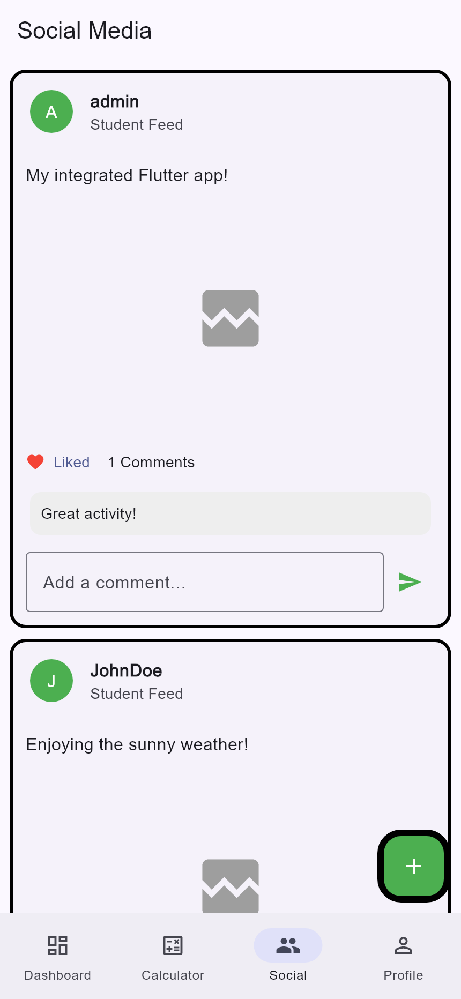

# Integrated Student App Activity

**Name:** Charles Jayson R Roque  
**Student ID:** 555646  
**Course:** BSIT  
**Section:** 3447  
**Subject:** CCE 106  
**Repository:** https://github.com/CharlesJaysonRoque555646/ROOM-ACT-7-INTEGRATED-FLUTTER-STUDENT-APPLICATION

## Application flow

Register -> Login -> Dashboard -> Calculator -> Social -> Profile -> Logout.

The Dashboard, Social post author, and Profile session label use the logged-in username. Student details remain fixed as required by the activity. Logout clears the session and all previous routes. Calculator and Social state remain while switching tabs during a login session.

## Testing

Verification: 28 automated Flutter tests passed, covering all 14 activity scenarios, calculator operations, validation, logout, registered-account identity, and earlier feed checks. Screenshots are actual Flutter widget captures. The test harness blocks network images, so the screenshots show the app's broken-image fallback; successful live image downloads and a device/browser demonstration are not claimed. Tests ran directly in the Flutter engine because this environment blocks the standard test runner socket.

| No. | Test | Expected Result | Pass/Fail |
| --- | --- | --- | --- |
| 1 | Open the application. | Login appears first. | Pass |
| 2 | Submit empty login fields. | Validation messages appear. | Pass |
| 3 | Enter incorrect credentials. | Login is rejected. | Pass |
| 4 | Enter admin / admin123. | Dashboard opens. | Pass |
| 5 | Read the dashboard greeting. | Displays Welcome, admin! | Pass |
| 6 | Open Calculator and calculate 10 + 5. | Displays 15.0. | Pass |
| 7 | Switch tabs and return to Calculator. | Inputs and result remain. | Pass |
| 8 | Create a social post. | Post displays the logged-in username. | Pass |
| 9 | Like a post and add a comment. | Both interactions update correctly. | Pass |
| 10 | Switch tabs and return to Social. | Posts, likes, and comments remain. | Pass |
| 11 | Open Profile. | Student information and username appear. | Pass |
| 12 | Tap Logout. | Login appears; Back does not reopen MainScreen. | Pass |
| 13 | Register a valid account and log in. | Dashboard displays the registered username. | Pass |
| 14 | Create a post using the registered account. | Post displays the registered username. | Pass |

Additional calculator checks: with 20 and 5, the results are 25.0, 15.0, 100.0, and 4.0. Empty-input validation, division by zero, and Clear also passed.

## Guide Questions

### 1. How does DemoAuth connect Login to Dashboard, Social, and Profile?

DemoAuth checks the login credentials and saves the accepted username in currentUsername. MainScreen reads this value in initState() and passes it to Dashboard, Social, and Profile.

### 2. Why must the order of pages match the bottom navigation destinations?

The selectedIndex identifies both the selected destination and its position in the pages list. Keeping their order the same ensures that tapping Social displays the Social page rather than another page.

### 3. Why is IndexedStack useful for the Calculator and Social pages?

IndexedStack keeps its pages mounted while showing the selected page. Calculator inputs and results, along with Social posts, likes, and comments, therefore remain available when switching tabs.

### 4. Why should Logout clear the current username and remove previous routes?

Clearing currentUsername ends the demo session and removes the active account identity. Removing previous routes prevents the Back action from reopening MainScreen after logout.

### 5. Which information is lost when this demo application restarts?

The registered account, current username, created posts, likes, comments, and calculator inputs/results are lost because they exist only in memory. The default admin account and the built-in sample posts remain available because they are defined in the code.

## Screenshots

### Login

The application starts on Login.

### Register

Registration validates the username, six-character password minimum, and matching confirmation. Eye icons control visibility.

### Dashboard

Dashboard welcomes the logged-in account and describes the available pages.

### Calculator

The existing calculator displays 15.0 for 10 + 5.

### Social

The reused feed shows its sample posts, Like/Comment controls, and Create Post button.

### Profile

Fixed student details are retained. The active username and Logout button appear in Profile.

### Social: Post, Like, and Comment

A new post displays admin, its liked state, and the submitted comment.

## Submission note

The report and current integration changes are local. Google Docs upload, GitHub push for this update, and Blackboard submission have not been performed.
