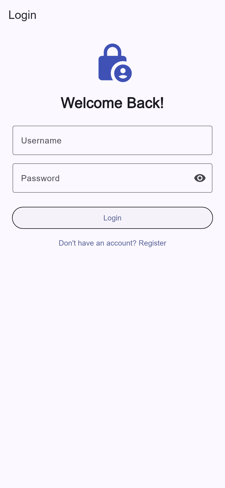
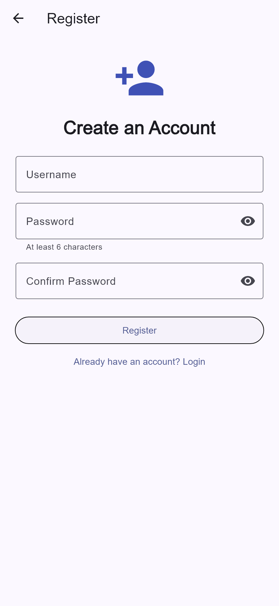
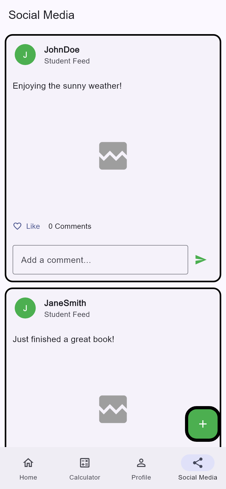
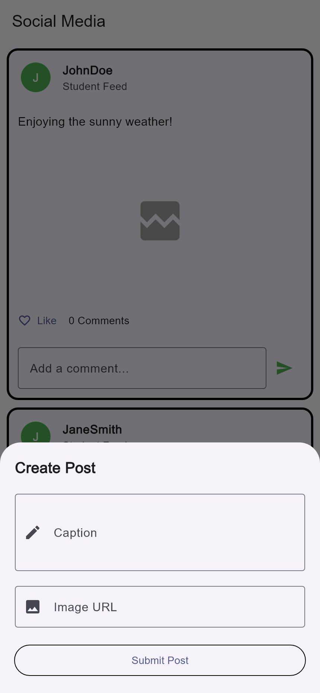
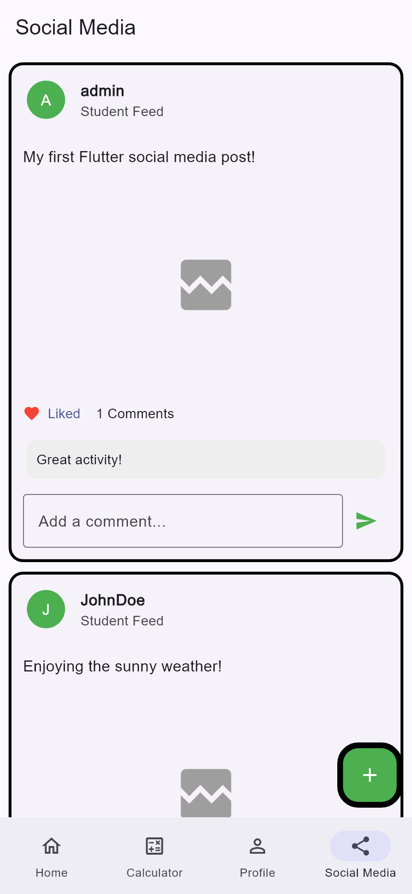

# Social Media Feed Activity

**Name:** Charles Jayson R Roque  
**Course and Section:** BSIT - 3447  
**Student ID:** 555646  
**Subject:** CCE 106  
**Repository:** https://github.com/CharlesJaysonRoque555646/roomactivity5-navigation-flutter

## Implementation

The existing Login, Register, Home, Calculator, Profile, and MainScreen remain. The Social Media tab opens the new feed. DemoAuth.currentUsername identifies new posts. The Home Logout button clears the session and removes all previous routes.

Registration requires at least three username characters, reserves admin, requires at least six password characters, and checks confirmation. Password eye controls remain. The full existing profile content is retained.

IndexedStack preserves the feed across tabs. ObjectKey, findChildIndexCallback, and card keep-alive keep likes and comments attached to the correct post after insertion or scrolling. Accounts, posts, likes, and comments are in memory and reset on application restart.

## Test Results

Verification uses 13 passing automated Flutter tests, run directly in the Flutter test engine because the sandbox blocked the standard runner socket. The 11 activity scenarios pass; two additional tests cover registration validation/eye icons and authentication failures. Screenshots are actual widget captures at a 430 x 932 logical-pixel viewport. The test harness returns HTTP 400 for network images, so these captures verify the broken-image fallback, not successful live image downloads. A live Android/browser demonstration is still required. The web release build was blocked by a sandbox restriction on the SDK telemetry cache.

| Test | Expected Result | Pass/Fail |
| --- | --- | --- |
| Log in using the default admin account. | MainScreen opens. | Pass |
| Open Social Media. | Two sample posts appear. | Pass |
| Submit a post with empty fields. | Validation message appears; form stays open. | Pass |
| Submit a post with an invalid URL. | HTTP/HTTPS URL validation message appears. | Pass |
| Submit a valid post. | New post appears first with the logged-in username. | Pass |
| Tap Like twice. | Changes to Liked, then back to Like. | Pass |
| Add a nonempty comment. | Comment appears, count increases, input clears. | Pass |
| Submit a blank comment. | No comment is added. | Pass |
| Like a sample post, then create another post. | Original post retains its like and comment; new post is not liked. | Pass |
| Switch to Home and return. | Posts, likes, and comments remain. | Pass |
| Log out, register, and log in with a new account. | Logout clears the session and route stack; new posts use the registered username. | Pass |

## Code Tracing

| Action | Method or Statement | What Happens? |
| --- | --- | --- |
| Successful login | `DemoAuth.login()` | Checks the default and registered credentials. On success, saves currentUsername and returns true; Login replaces itself with MainScreen. |
| Tap the + button | `openCreatePostSheet()` | Opens the keyboard-aware modal form with the current username and waits for its result. |
| Submit a valid post | `Navigator.pop(context, newPost)` | After caption and URL validation, closes the form and returns the new Post to the feed. |
| Receive the new post | `posts.insert(0, newPost)` | Adds the post at index zero inside setState, rebuilding the feed with the newest post first. |
| Tap Like | `isLiked = !isLiked` | Toggles the card boolean inside setState; the heart and Like/Liked label update. |
| Send a comment | `comments.add(comment)` | Adds the trimmed, nonempty comment inside setState, increases the count, and clears the input. |

## Screenshots

### Login

Login form with username, password, visibility control, and registration link.

### Register

Registration form with username, six-character password minimum, confirmation, and eye icons.

### Social Media Feed

Sample posts from JohnDoe and JaneSmith. Images show the error fallback because the widget-test harness blocks network requests.

### Create Post

Create Post modal with caption, image URL, and Submit Post controls.

### Post with Username, Like, and Comment

The new post uses admin, shows Liked, and displays the submitted comment and updated count.

## Submission Status

These changes and screenshots are local. The existing GitHub link is recorded above; the updated files still need to be pushed. Google Docs population was blocked by automatic approval review pending authorization to include personal student information. This local PDF is a report copy, not an export from a completed Google Doc. Blackboard submission has not been performed.
